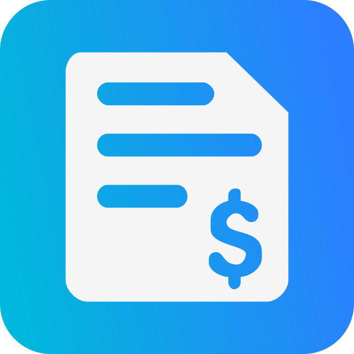

<h1 align="center">QuickBill</h1>

 
  
 <b>Tu sistema de facturación multiplataforma</b>
  
 Facturas, equipo, clientes... todo conectado en una sola aplicación.

## 🚀 Descripción

QuickBill es una aplicación multiplataforma diseñada para simplificar la facturación y gestión financiera para empresas de todos los tamaños. Proporciona una interfaz intuitiva para crear y gestionar facturas, realizar seguimiento de pagos y generar informes detallados, todo ello sincronizado entre dispositivos iOS, Android y Web.

  

## ✨ Características Principales

- **Gestión de Facturas**: Crea, edita y gestiona facturas con un diseño profesional.
- **Seguimiento de Pagos**: Monitoriza el estado de pagos y recibe notificaciones de facturas vencidas.
- **Gestión de Clientes**: Mantén una base de datos de clientes con información detallada.
- **Informes Financieros**: Genera informes detallados para análisis financiero.
- **Exportación a PDF**: Exporta facturas en formato PDF para compartir fácilmente.
- **Sincronización en la Nube**: Todos los datos se sincronizan entre dispositivos.
- **Interfaz Multilingüe**: Disponible en español e inglés.

## 💻 Plataformas Soportadas

### iOS

La implementación para iOS está construida utilizando Swift y SwiftUI, ofreciendo una experiencia nativa y fluida en dispositivos Apple.

**Tecnologías utilizadas:**

- **Firebase**: Autenticación y almacenamiento en la nube.
- **SwiftUI**: Para una interfaz de usuario moderna y reactiva.
- **Combine**: Para programación reactiva y gestión de estados.
- **PDFKit**: Para la generación y visualización de facturas en PDF.

### Android

> **Nota**: La versión de Android finalmente quedó sin desarrollar por falta de tiempo. A continuación se detallan las tecnologías que estaban planificadas para su implementación.

La implementación para Android estaba planificada para desarrollarse con Kotlin y Jetpack Compose, proporcionando una experiencia moderna y consistente con el diseño Material.

**Tecnologías planificadas:**

- **Firebase**: Autenticación y almacenamiento en la nube.
- **Jetpack Compose**: Para una interfaz de usuario declarativa y moderna.
- **Room Database**: Para almacenamiento local de datos.
- **LiveData y ViewModel**: Para programación reactiva y gestión de estados.

### Web

La implementación web está construida con Astro, ofreciendo una experiencia rápida y responsive accesible desde cualquier navegador.

**Tecnologías utilizadas:**

- **Astro**: Framework web moderno para sitios estáticos y dinámicos.
- **Firebase**: Autenticación y almacenamiento en la nube.
- **TypeScript**: Para un desarrollo más seguro y mantenible.
- **Tailwind CSS**: Para un diseño responsive y moderno.

## 📱 Capturas de Pantalla

Las capturas de pantalla de la aplicación se encuentran en la carpeta [`Memoria-TFT/Ilustraciones/`](./Memoria-TFT/Ilustraciones/).

## 🛠️ Arquitectura del Proyecto

El proyecto sigue una arquitectura MVVM (Model-View-ViewModel) en todas las plataformas, lo que permite una separación clara de responsabilidades y facilita el mantenimiento y la escalabilidad.

- **Models**: Representan los datos y la lógica de negocio.
- **Views**: Representan la interfaz de usuario.
- **ViewModels**: Actúan como intermediarios entre los modelos y las vistas, gestionando la lógica de presentación.

---

 Desarrollado con ❤️ por <a href="https://github.com/juancarlosacostaperaba">Juan Carlos Acosta Peraba</a>

